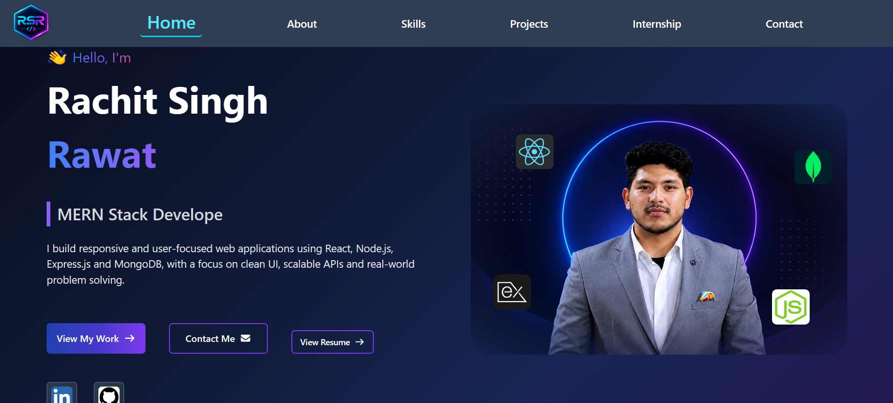
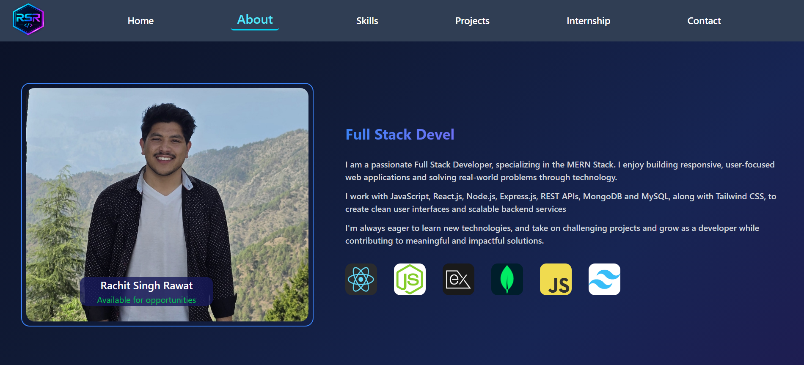
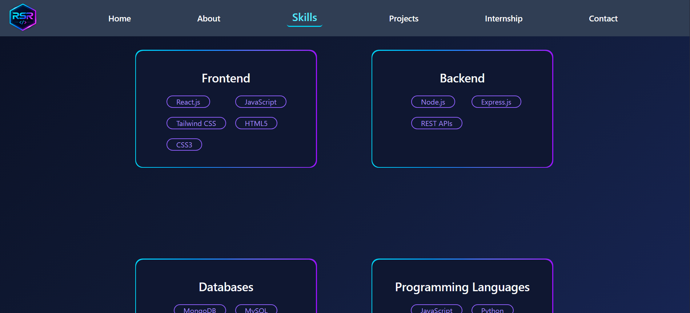
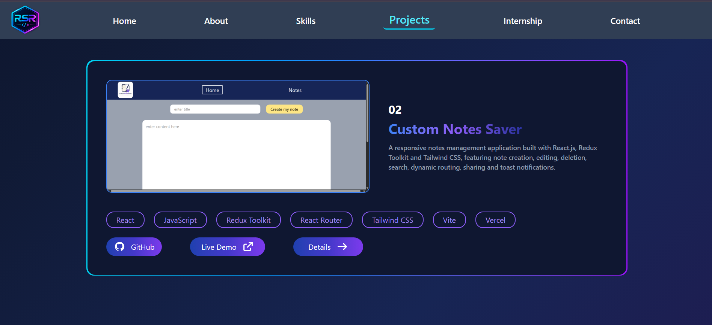
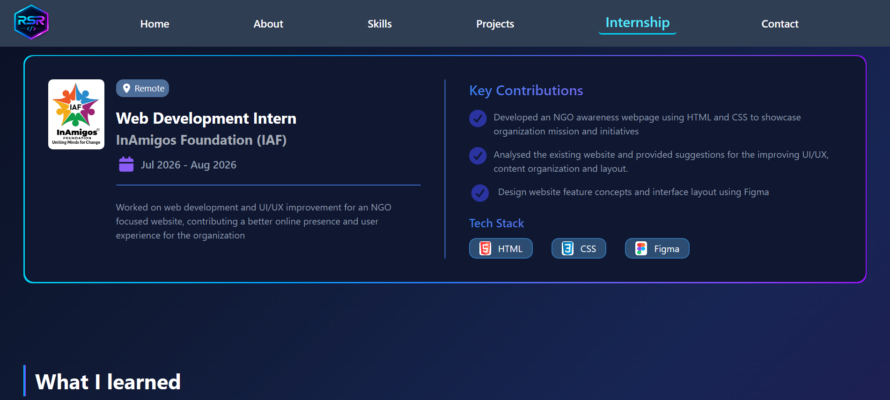
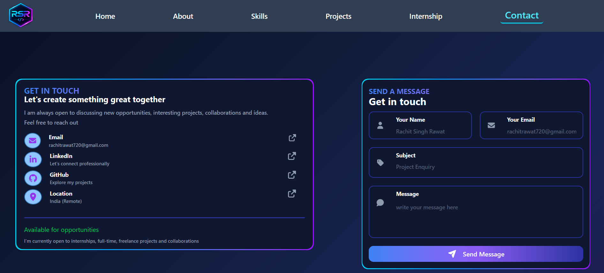

# 🚀 Personal Portfolio Website

A modern, responsive personal portfolio website built with **React.js, Vite, and Tailwind CSS** to showcase my skills, projects, internship experience, and professional journey as a developer.

The portfolio features a clean user interface, a dark-themed design, smooth visual effects, and a responsive layout that adapts to different screen sizes.

## 🌐 Live Demo

🔗 **Portfolio Website:** [Live link](https://rachit-rawat-portfolio.vercel.app/)

💻 **GitHub Repository:** [portfolio-website](https://github.com/RachitRawat720/portfolio-website)

## 📸 Portfolio Preview

## 📸 Portfolio Preview

### 🏠 Home Page


### 👤 About Page


### 🛠️ Skills Page


### 💼 Projects Page


### 🏢 Internship Page


### 📬 Contact Page


## ✨ Features

- 🎨 **Modern UI:** Clean design with a dark theme and gradient accents.
- 📱 **Responsive Design:** Optimized for desktop, tablet, and mobile devices.
- ⚛️ **React Components:** Reusable and maintainable component-based architecture.
- 🎭 **Typing Animation:** Animated text effects to make the introduction more engaging.
- 🧑‍💻 **About Me:** Introduction, background, and professional goals.
- 🛠️ **Skills Section:** Showcase of technical skills and technologies.
- 💼 **Projects Showcase:** Display of projects with descriptions and relevant links.
- 🏢 **Internship Section:** Highlights of internship experience and practical work.
- 📬 **Contact Section:** Provides ways to connect professionally.
- ✨ **Interactive UI:** Smooth transitions, visual effects, and interactive navigation.

## 🛠️ Tech Stack

| Technology | Purpose |
|---|---|
| React.js | Building reusable UI components |
| Vite | Development server and build tooling |
| JavaScript (ES6+) | Application logic and interactivity |
| Tailwind CSS | Responsive styling and UI design |
| HTML5 | Web page structure |
| Git & GitHub | Version control and source code management |

## 📂 Project Structure

```text
portfolio-website/
├── public/
│   └── assets/
├── screenshots/
│   ├── Home.png
│   ├── About.png
│   ├── Skills.png
│   ├── Projects.png
│   ├── Internship.png
│   └── Contact.png
├── src/
│   ├── components/
│   ├── App.jsx
│   ├── main.jsx
│   └── index.css
├── index.html
├── package.json
├── vite.config.js
├── README.md
└── .gitignore
```

*Note: The structure above is illustrative. Adjust it to match the actual folders and files in your repository.*

## 🚀 Getting Started

Follow these steps to run the project locally.

### Prerequisites

Make sure you have installed:

- [Node.js](https://nodejs.org/)
- npm (included with Node.js)
- Git

### 1. Clone the repository

```bash
git clone https://github.com/RachitRawat720/portfolio-website.git
```

### 2. Navigate to the project directory

```bash
cd portfolio-website
```

### 3. Install dependencies

```bash
npm install
```

### 4. Start the development server

```bash
npm run dev
```

### 5. Open in your browser

Open the local URL displayed in your terminal, usually:

```text
http://localhost:5173
```

## 🏗️ Build for Production

To create an optimized production build, run:

```bash
npm run build
```

To preview the production build locally, run:

```bash
npm run preview
```

The generated production files will be available in the `dist/` directory.

## 🎯 Purpose of the Project

The purpose of this project is to build a professional online presence where recruiters, developers, and potential collaborators can explore my technical skills, projects, and internship experience.

It also serves as a practical demonstration of my knowledge of React.js, responsive web design, component-based development, and modern front-end technologies.

## 👨‍💻 About Me

Hi! I'm **Rachit Rawat**, an aspiring developer passionate about building responsive, interactive, and user-friendly web applications.

I enjoy learning new technologies, solving problems, and developing projects that strengthen my front-end and full-stack development skills.

## 🤝 Connect With Me

- **GitHub:** [RachitRawat720](https://github.com/RachitRawat720)
- **LinkedIn:** [Rachit-Singh-Rawat](https://www.linkedin.com/in/Rachit-Singh-Rawat)
- **Portfolio:** [Live link](https://rachit-rawat-portfolio.vercel.app/)

## ⭐ Show Your Support

If you find this project interesting, consider giving the repository a ⭐ on GitHub!

---

**Built with ❤️ by Rachit Rawat**
